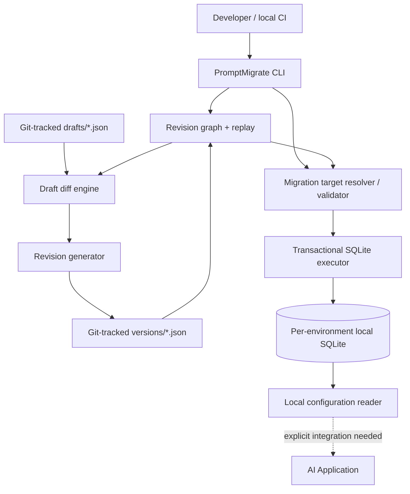
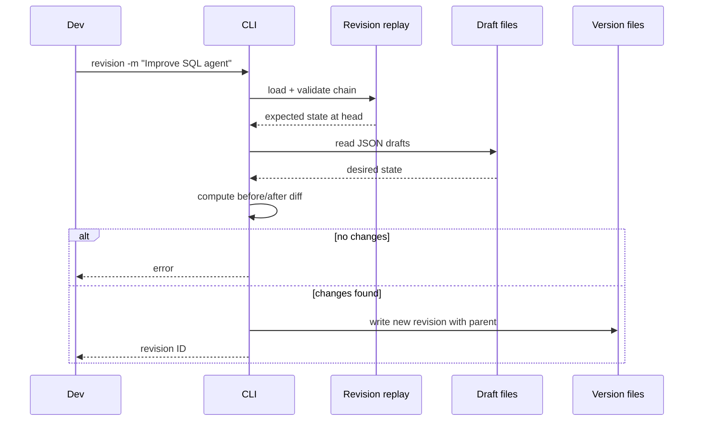
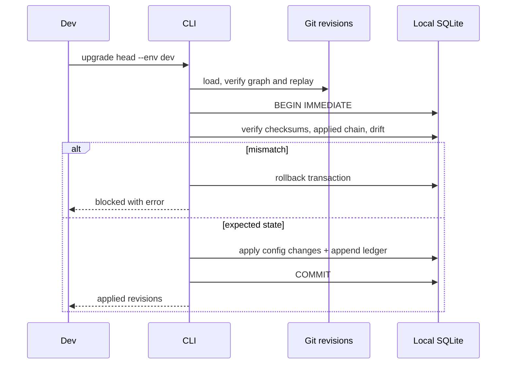
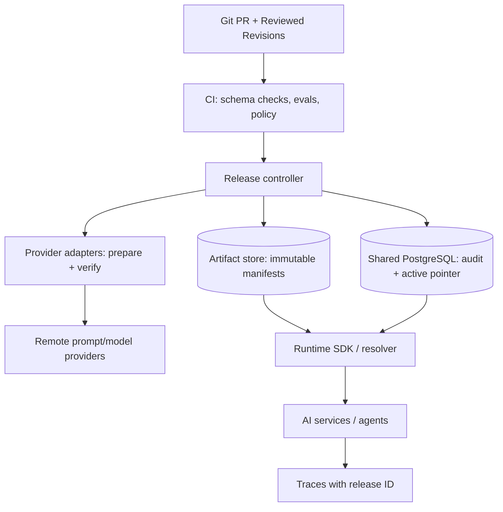

# HIGH-LEVEL DESIGN (HLD) — PromptMigrate

## Architectural thesis

Migrations apply **declarative configuration state transitions**, not executable Python and not direct provider API calls in the initial MVP. Source control stores desired config and migrations; a local ledger records applied revisions. The production vision adds an immutable release bundle and a separately controlled runtime activation pointer.

## Current local prototype architecture

**Important:** The dashed line means *not wired by default*. Writing to `states/dev.sqlite3` does **not** change a running application's hardcoded prompts.

## Four distinct states

1. **Drafts:** `.promptmigrate/drafts/*.json` — developers' desired next configuration.
2. **Source migration history:** `.promptmigrate/versions/*.json` — reviewed ordered revisions. Replaying them reconstructs source `head`.
3. **Applied environment state:** `.promptmigrate/states/<env>.sqlite3` — applied revision ledger and named config snapshots.
4. **Runtime active release:** what an actual service reads. **Not implemented** in prototype; requires an SDK/adapter and deployment mechanism.

A Git branch containing revision `r003` does not mean any running environment has applied it.

## Local flows

### Create revision

### Apply migration

## Component boundaries

| Component | Input | Output | Owns |
|---|---|---|---|
| CLI | flags, args, cwd | stdout/stderr, exit code | user interaction |
| Draft loader | draft directory | name → JSON config | parsing/validation |
| Revision loader/graph | version directory | validated linear list | ordering/dependencies |
| Diff/generator | head state + drafts | revision artifact | version content |
| Planner | source chain + env state + target | ordered steps | target semantics |
| Executor | planned transitions + DB | applied state and ledger | SQLite transaction |
| Verifier | revisions + env state | OK or failure | integrity/drift |
| Reader | environment/name | applied config | local lookup |

## Future production architecture — **not yet implemented**

### Production deployment protocol (target)

1. Build an immutable **release manifest** of compatible configs.
2. Validate schema, code/tool compatibility, and evaluation policy.
3. Prepare/provider-upload assets idempotently, without exposing them as active.
4. Verify all immutable assets exist and match expected content hash.
5. Atomically compare-and-swap the **active release pointer** in a shared transactional store.
6. Runtime SDK resolves verified manifest by immutable release ID; sessions may pin release at start.
7. Record deployment actor, evaluation evidence, and rollback ancestry.
8. For rollback, **reactivate previous release pointer**, not blindly rewrite every prompt.

The above only guarantees pointer atomicity **if** the runtime genuinely resolves all configuration via that pointer and handles caching/in-flight sessions. Provider-side writes remain non-atomic external operations. No distributed ACID claim.

## Deployment topology

- **MVP:** installed Python package, one local `.promptmigrate` workspace, one SQLite DB file per named environment.
- **Future:** CI/release-controller client, PostgreSQL coordinator, immutable object store, optional registry adapters, runtime SDK (no dashboard requirement).
- **Trust boundaries:** Git/source; local writable state; central control plane; external API credentials; runtime workloads.

## Failure philosophy

- Invalid revision graph → reject.
- Applied checksum differs → reject.
- Applied state differs from reconstructed state → reject.
- Conflicting concurrent writes → serialize or reject, never silently last-write-wins.
- Remote prepare fails → never activate incomplete release; reconcile later.
- Controller unavailable → applications may continue using cached **previously verified** immutable release, with explicit policy.

## Key tradeoffs

- **Snapshots vs patches:** snapshots consume more Git storage but simplify reversibility and validation.
- **JSON vs YAML:** JSON is simpler to parse/canonicalize; YAML can follow as a normalized input format.
- **Linear graph vs branches:** linear graph reduces initial complexity; conflicts must be resolved before migration.
- **SQLite vs Postgres:** SQLite is sufficient for local isolation, not global multi-host release coordination.
- **CLI vs dashboard:** CLI enables automated tests and reproducibility before user-facing UI investment.

## Out of scope for current architecture implementation

No remote production deployment, no credential management, no runtime traffic routing, no real-time eval service, no UI, no signed revision trust chain, no remote drift detection, and no guaranteed rollback of agent side effects.
