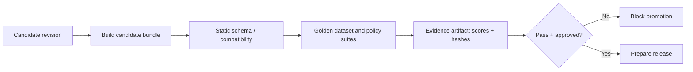

# EVALUATION GATES & RELEASE ACTIVATION — Future architecture

> **Not implemented in current local prototype.** This document separates AI quality gates and distributed release promotion from the core SQLite migration engine.

## Why migration correctness is not AI correctness

A revision may be syntactically valid and apply cleanly yet cause hallucinations, refusal failures, output parsing errors, unexpected tool invocations, data leakage, or unacceptable costs. `check` validates consistency, **not** model behavior. AI quality requires a separate evaluation pipeline.

## Proposed evaluation policy

```yaml
# Illustrative policy only — not a supported CLI file format today
suite: sql_agent_regression
cases: tests/evals/sql_agent_cases.jsonl
checks:
  - type: json_schema
    required_pass_rate: 1.0
  - type: prohibited_tool_use
    required_pass_rate: 1.0
  - type: task_correctness
    minimum_score: 0.95
  - type: latency_budget
    p95_ms: 3000
```

Thresholds above are **examples**, not universal recommended production values. Actual evaluations need domain-specific datasets, sample sizes, uncertainty handling, and explicit critical safety cases.

## Eval pipeline



Evaluator plug-ins should not execute inside the SQLite transaction. Their signed/hashed evidence should bind to a release/configuration content hash; otherwise an evaluation on one prompt could be wrongly reused for another.

## Immutable release manifest (future schema sketch)

```json
{
  "manifest_version": 1,
  "release_id": "sha256:<content-hash>",
  "source_revision": "b2c3d4e5f6a7",
  "configs": {
    "sql_agent": {"artifact": "sha256:<hash-a>"},
    "reviewer": {"artifact": "sha256:<hash-b>"}
  },
  "compatibility": {"application_api": "agent-config-v1"},
  "evaluation_evidence": ["sha256:<eval-report-hash>"],
  "created_at": "2026-10-29T12:00:00Z"
}
```

The hash placeholder above is explanatory, not a current interoperable standard. Canonical bytes and signature semantics require a formal specification.

## Deployment state (future)

```sql
-- Illustrative, not an existing schema.
CREATE TABLE environment_activations (
  environment TEXT PRIMARY KEY,
  active_release_id TEXT NOT NULL,
  generation BIGINT NOT NULL,
  activated_at TIMESTAMPTZ NOT NULL
);
```

Activation uses expected `generation` compare-and-swap inside Postgres. Only one complete, verified immutable release becomes current. Append-only audit records capture who promoted or rolled back and why.

## Runtime SDK (future)

- Resolve an immutable `release_id` at request/session start.
- Load every config from the **same release manifest**.
- Cache verified immutable assets safely; revalidation policy for mutable environment pointers.
- Expose release/config version IDs in traces without leaking private prompts.
- Decide how to behave when controller is offline: pinned verified manifest vs explicit failure (policy-defined).
- Avoid mixing different release versions during a multi-agent workflow.

## Failures and rollback

- A provider prepare failure must not change active pointer.
- Unconfirmed asset writes require idempotent retry and reconciliation.
- Activation race requires CAS/locking.
- Emergency rollback returns active pointer to a **previous approved manifest**.
- Rollback doesn't reverse agent actions or external database writes.
- Runtime refresh/in-flight session semantics must be specified and tested.

## Integration strategy

First add an SDK that can read a local exported immutable artifact; this closes the loop between CLI state and an application. Only later add adapters to existing registries. Do not bind the core migration protocol to LangGraph, Microsoft Foundry, OpenAI, or any one provider.
