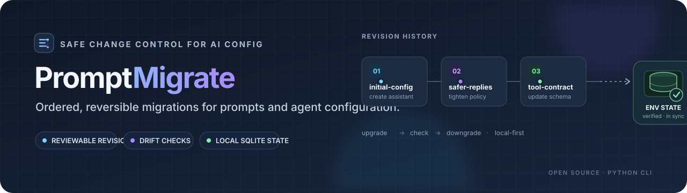

<p align="center">
  
</p>

# PromptMigrate (working name)

**An Alembic-inspired, migration-first CLI for production AI prompts and agent configuration.**

This is a working **v0.1 local prototype**, not a production deployment service. It keeps Git-tracked, immutable-in-practice revision files for JSON prompt/agent configs. The CLI applies revisions to independent SQLite environment states and rejects drift and modified, already-applied revisions. It does **not** automatically deploy to Langfuse, Foundry, OpenAI, or another runtime.

> **Design docs:** see [`docs/`](docs/) — start with [`docs/HANDOFF.md`](docs/HANDOFF.md). The original starter's architecture note is kept at [`docs/archive/STARTER_ARCHITECTURE.md`](docs/archive/STARTER_ARCHITECTURE.md).

## Why another prompt tool?

Langfuse, MLflow, Agenta, and promptctl already offer prompt versioning, management, labels, or testing. PromptMigrate is intentionally focused on an **ordered configuration migration protocol**: a migration chain with explicit predecessor revision, reversible before/after state, deterministic upgrade/downgrade behavior, environment state comparison, and CI exit codes. It could eventually integrate with those registries instead of competing with them.

Read:
- https://alembic.sqlalchemy.org/en/latest/api/commands.html
- https://langfuse.com/docs/prompt-management/overview
- https://mlflow.org/docs/latest/prompts
- https://agenta.ai/docs/prompt-management/overview/

## Install

Python 3.10+. In this source checkout:

```bash
python -m pip install -e .
```

This only uses Python's standard library at runtime.

## Five-minute example

In a separate empty project directory:

```bash
promptmigrate init
promptmigrate env list
promptmigrate env add qa
# Edit .promptmigrate/drafts/assistant.json with the desired system prompt,
# model, temperature, tool specs, response schema, etc.
promptmigrate revision -m "initial assistant prompt"
promptmigrate history
promptmigrate plan --env dev --target head
promptmigrate upgrade head --env dev
promptmigrate check --env dev --require-head
promptmigrate get assistant --env dev
```

Then edit `.promptmigrate/drafts/assistant.json`, and run:

```bash
promptmigrate diff
promptmigrate revision -m "strengthen refusal instructions"
promptmigrate upgrade head --env staging
promptmigrate current --env staging
promptmigrate downgrade -1 --env staging
```

A revision describes the change from the previous Git-tracked version, **not the state of your local dev database**. Generate a revision only after integrating the latest revisions from your team. For multi-agent systems, add more named files under `.promptmigrate/drafts/`, e.g. `planner.json`, `sql_agent.json`, or `reviewer.json`. Deleting a draft and creating a revision explicitly deletes the prompt in a target environment, with reversible history.

A runnable two-agent walkthrough (init → revision → upgrade → check → downgrade) is in [`examples/multi-agent-basic/`](examples/multi-agent-basic/).

## Example declarative migration

The tool generates a JSON revision like this (abbreviated):

```json
{
  "format_version": 1,
  "revision": "0123456789ab",
  "down_revision": null,
  "message": "initial assistant",
  "created_at": "2026-10-29T00:00:00+00:00",
  "changes": {
    "assistant": {
      "before": null,
      "after": {
        "messages": [{"role": "system", "content": "You are helpful."}],
        "model": "provider/model-id",
        "parameters": {"temperature": 0}
      }
    }
  }
}
```

`before` and `after` are **full JSON snapshots**, not executable code. This makes deterministic reversal possible but has size and Git secret-retention tradeoffs. `null` indicates absent prompt. A revision can change multiple prompts in one atomic transaction.

## Commands

| Command | Behavior |
|---|---|
| `init` | Create migration workspace and a starter draft |
| `diff` | Compare local drafts with Git-tracked migration head |
| `revision -m "..."` | Generate a revision from the draft changes |
| `history` | Print revision lineage |
| `current --env dev` | Display current revision for environment |
| `upgrade head --env dev` | Apply pending migrations atomically |
| `plan --env dev [--target head]` | Preview the revisions and config changes an upgrade or downgrade would apply; writes nothing |
| `downgrade -1 --env dev` | Undo the last applied revision |
| `downgrade base --env dev` | Revert all applied revisions |
| `check --env dev --require-head` | Detect drift, tampered migration files, and pending changes |
| `get assistant --env dev` | Read a local environment's active prompt config |
| `env add qa` | Declare a local environment without creating its database |
| `env list` | List declared environments and whether local state exists |

To target a different local repository location, use the global flag `promptmigrate --project /path/to/repo history`.

## Layout

```text
project/
  .promptmigrate/
    drafts/                # desired JSON prompt configurations (Git tracked)
      assistant.json
    environments.json      # declared local environment names and metadata (Git tracked)
    versions/              # migrations with before/after state (Git tracked)
      <revision>_<message>.json
    states/                # local environment SQLite databases (gitignored)
      dev.sqlite3
      staging.sqlite3
    .gitignore
```

`states/prod.sqlite3` is only a **local simulation named prod**, not a shared or production deployment state! For true multi-host environments we need a central Postgres-backed coordination service / provider adapter and an atomic activation pointer. Never mistake local SQLite files for globally deployed state.

`init` declares `dev` and `staging`. Environment names resolve case-insensitively to their canonical spelling in `environments.json`, including CLI status labels. Existing projects without that file are inferred in memory; they always include `dev` and `staging`. The first successful mutation persists the manifest and prints an adoption warning; a rejected command writes nothing. `check`, `current`, and `get` use read-only database connections; missing state is the empty base state, and reads never create or repair databases. `env list` reports `<name>: state exists` or `<name>: no state` without opening SQLite. WAL-mode state databases are rejected by read-only commands to prevent SQLite sidecar creation.

## CI example

GitHub Actions runs the complete test suite inside Linux Docker containers for
Python 3.10, 3.12, and 3.13. To run the Python 3.12 container locally:

```bash
docker build -f Dockerfile.ci -t promptmigrate-ci .
docker run --rm promptmigrate-ci
```

CI runs the complete suite in Linux containers and natively on Windows and
macOS for Python 3.10, 3.12, and 3.13. Python 3.11 remains covered by the
local Windows merge gate.

```yaml
- run: python -m pip install -e .
- run: python -m unittest discover -s tests -v
- run: promptmigrate history
- run: promptmigrate diff
```

For a real production rollout the future release pipeline must additionally run mandatory eval suites, require approval, ensure state and provider consistency, check migration drift with shared state, and only then activate the new release. A passing `check` **does not measure answer quality or prompt-injection resistance**.

## Tests

```bash
python -m pip install -e ".[dev]"
python -m pytest -q                                      # whole suite: tests/{unit,integration,contract,security}
PYTHONPATH=src python -m unittest discover -s tests -v   # the original seven starter tests
```

Tests cover revision generation, history, separate environment revisions, deterministic rollback, deletion, drift detection, tampered migration files, multiple prompt migrations, strict parsing, declared environments, read-only reads and the secret safeguard. See [`CONTRIBUTING.md`](CONTRIBUTING.md) for how to contribute and where each part of the code lives.

## Safety and integrity guarantees in v0.1

- Entire multi-revision apply/revert transaction is atomic **inside a single local SQLite database**.
- Migration contents are hashed when applied; editing an applied revision fails verification.
- Unexpected in-place changes to local deployed prompts are rejected as **drift**.
- Supported migration history is **one linear revision chain**; parallel branches require manual resolution first.
- Config documents are pure JSON; **no arbitrary migration Python is executed**.
- No provider API keys or network calls are required.
- Secret-like values are refused in new revision content and redacted in `diff`/`get` output. Detection is heuristic and can miss secrets; secrets already committed stay in Git and must be rotated.

**Not yet guaranteed:** distributed transactions with model providers; locks across hosts; remote state durability; signed revisions; user authentication/authorization; prompt eval gates; runtime cache invalidation; canary releases; audit-grade append-only history; automated recovery when external APIs partially fail. Never use this MVP to administer live production prompts or production secrets.

## Suggested roadmap

**v0.2:** evaluators (golden set / schema / security), policy-as-code gates, required review approvals.

**v0.3:** Postgres coordination DB, remote registry adapters, outbox + reconcile loop, reconcile/repair commands, SDK resolution by immutable release manifest.

**v0.4:** signed revisions, role-based approvals, staged/canary promotion, metrics-driven rollback, runtime feature flags and cache invalidation.

## Architecture direction

```text
Git drafts ─> revision generator ─> reviewed immutable revision files
                                               |
                                         plan + evaluation
                                               |
                                           approval gate
                                               |
                                     environment migration engine
                                               |
                              registry adapters + release manifest
                                               |
                               AI app/agent runtime resolves release
```

Prompt releases should eventually version **bundles**, not just one string: system/developer messages, model and parameters, tools, response schema, guardrails, routing metadata, and evaluation suite ID. Never place secrets in versioned content; use secret references.

## License

MIT. A final package/repository name should be checked for conflicts before publishing to PyPI or GitHub.

<!-- gumroad-footer -->
---

### More free resources

I share free visual notes, agent skills and guides on AI agents, Google ADK, RAG and LLMs.

[](https://himanshu231204.gumroad.com) → **[himanshu231204.gumroad.com](https://himanshu231204.gumroad.com)**
